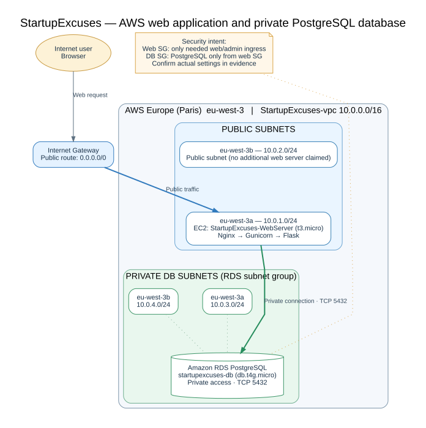

# StartupExcuses — Secure AWS Web Application Deployment

**Cloud engineering · AWS networking · Linux · Python/Flask · PostgreSQL · Infrastructure security**

A hands-on AWS lab demonstrating a Flask web application deployed on an Amazon EC2 instance, served through Nginx and Gunicorn, and connected to a PostgreSQL database hosted on Amazon RDS in private subnets.

The focus of this portfolio project is **network isolation, least-privilege access, reliable application service management, and verifiable deployment evidence**. Screenshots represent the lab's configuration and tests at the time they were captured; they are not a claim of ongoing production availability.

> Repository status: AWS infrastructure documentation and 25 sanitized evidence screenshots uploaded successfully. Application source code pending final security review. No credentials, SSH private keys, or environment files should be published.

## Architecture



See the [editable Mermaid diagram](docs/architecture.md) and its [Graphviz source](docs/architecture.dot).

| Component | Configuration used in the lab |
|---|---|
| AWS Region | Europe (Paris), `eu-west-3` |
| VPC | `StartupExcuses-vpc` — `10.0.0.0/16` |
| Public subnet (AZ a) | `10.0.1.0/24`, `eu-west-3a` |
| Public subnet (AZ b) | `10.0.2.0/24`, `eu-west-3b` |
| Private DB subnet (AZ a) | `10.0.3.0/24`, `eu-west-3a` |
| Private DB subnet (AZ b) | `10.0.4.0/24`, `eu-west-3b` |
| Web compute | Amazon EC2 `StartupExcuses-WebServer` (`t3.micro`) |
| Web stack | Nginx → Gunicorn → Flask |
| Database | Amazon RDS PostgreSQL `startupexcuses-db` (`db.t4g.micro`) |
| Database port | TCP 5432 |
| Public routing | Public route table: `0.0.0.0/0` → Internet Gateway |
| Private DB routing | Local VPC routes only; no default Internet Gateway route |

The two public subnets show the VPC's public network design; the documented web server is **one EC2 instance**, not an asserted multi-AZ web deployment. The private subnets provide a database subnet group spanning two availability zones; this does **not**, by itself, imply that RDS was configured as Multi-AZ.

## Request and data flow

1. A client sends an HTTP request to the EC2 web server using its public network path.
2. Nginx forwards application traffic to Gunicorn.
3. Gunicorn runs the Flask `StartupExcuses` application as a managed service.
4. Flask connects to the RDS PostgreSQL endpoint using a private VPC connection on TCP 5432.
5. The application returns its response to the client. Database traffic does **not** require a public RDS endpoint.

No HTTPS certificate, load balancer, autoscaling, or multi-AZ database deployment is claimed in this lab documentation.

## Security decisions and verification

| Design decision | Security purpose | Evidence to inspect |
|---|---|---|
| Public and private subnet separation | Limit exposure of database resources | `01`, `21`–`25` |
| Database not publicly accessible | Prevent direct Internet connections to PostgreSQL | `05`, `08` |
| Separate web and database security groups | Restrict ingress by purpose and source | `02`, `03`, `19`, `20` |
| RDS encryption settings reviewed | Document encryption-at-rest configuration; confirm the setting in screenshot | `06` |
| Gunicorn managed via systemd | Start and monitor the web process consistently | `16`–`18` |
| Application and database connectivity tested | Demonstrate functional stack and network reachability | `11`–`15` |

**Important checks before describing these as enforced controls:** confirm that the RDS security group accepts TCP 5432 **only from the web-tier security group**, that SSH on port 22 is restricted to a trusted administrative IP (or not exposed), that RDS shows `Public access: No`, and that encryption is enabled if claimed. Security group rule screenshots are the evidence of the actual configuration; the table above describes design intent, not an independent audit.

## Lab validation

The evidence set is organized to show:

- EC2 deployment and SSH connection (`09`–`10`)
- Private EC2-to-RDS PostgreSQL connection (`11`)
- Flask application launch and health check (`12`–`13`)
- Web UI and submission/voting workflow (`14`–`15`)
- Gunicorn process, systemd unit, and restart/health check (`16`–`18`)
- Subnet routing, associations and security groups (`19`–`25`)

For all 25 expected screenshot filenames, see the [evidence checklist](evidence/README.md). Actual images are **not packaged** with this starter; copy them to `evidence/` after reviewing and redacting sensitive data.

## Repository layout

```text
StartupExcuses-AWS-GitHub/
├── README.md
├── .gitignore
├── SECURITY.md
├── docs/
│   ├── architecture.md          # Mermaid diagram, editable on GitHub
│   ├── architecture.dot         # Graphviz diagram source
│   ├── architecture.svg         # Rendered architecture diagram
│   └── aws-cleanup.md           # Cost-aware teardown checklist
├── evidence/
│   ├── README.md                # Checklist of all 25 screenshots
│   └── (add 01–25 PNG files here)
└── scripts/
    └── check-evidence.ps1       # Checks evidence completeness on Windows
```

Application source is not present in this documentation bundle, and no source-code audit has been performed. Add only reviewed Flask application files, dependency manifests and sanitized configuration examples if you want to publish the code too.

## Publish safely to GitHub

1. Place the original PNG screenshots in `evidence/` using the exact filenames in the [evidence checklist](evidence/README.md). Check screenshots for secrets and personal information before uploading.
2. Copy your application source only after manually reviewing it for embedded credentials, database URLs, secrets and local files.
3. Review the [security publishing checklist](SECURITY.md). `.gitignore` helps avoid accidental commits, but **does not clean credentials already present in Git history**.
4. On Windows PowerShell, from the repository directory, run:

```powershell
powershell -ExecutionPolicy Bypass -File .\scripts\check-evidence.ps1

git init
git branch -M main
git add .
git status --short
# Review staged files and check for potential secrets before committing:
git diff --cached --name-only
git diff --cached --check
git commit -m "Document secure StartupExcuses AWS deployment"
```

Then create a new **empty** repository on GitHub and connect it with the URL GitHub provides:

```powershell
git remote add origin https://github.com/YOUR-USERNAME/startupexcuses-aws.git
git push -u origin main
```

Do not add a password or access token to the remote URL. Use Git Credential Manager or another secure authentication method when prompted.

## Lessons learned

- Network placement and route tables are as important as application code.
- RDS private access and web-to-database reachability can be tested separately from Internet exposure.
- Process supervision with systemd is different from running a Flask development server interactively.
- A technical portfolio is stronger when each security decision is backed by clear evidence.
- Cloud teardown and residual storage/network charges are part of responsible lab operations.

## Possible next improvements

Provision a domain and HTTPS/TLS, replace direct SSH with Systems Manager where appropriate, automate provisioning with Terraform or CloudFormation, add application tests and dependency scanning, and improve application observability. These are **future enhancements**, not features claimed as deployed.

## Teardown and cost control

Follow [AWS cleanup](docs/aws-cleanup.md) **only after** confirming that you have everything needed for your portfolio. Termination/deletion is destructive; snapshots and storage can continue to be billed.

---

*Educational cloud security deployment for an engineering portfolio. This is not presented as a production-hardened service.*
