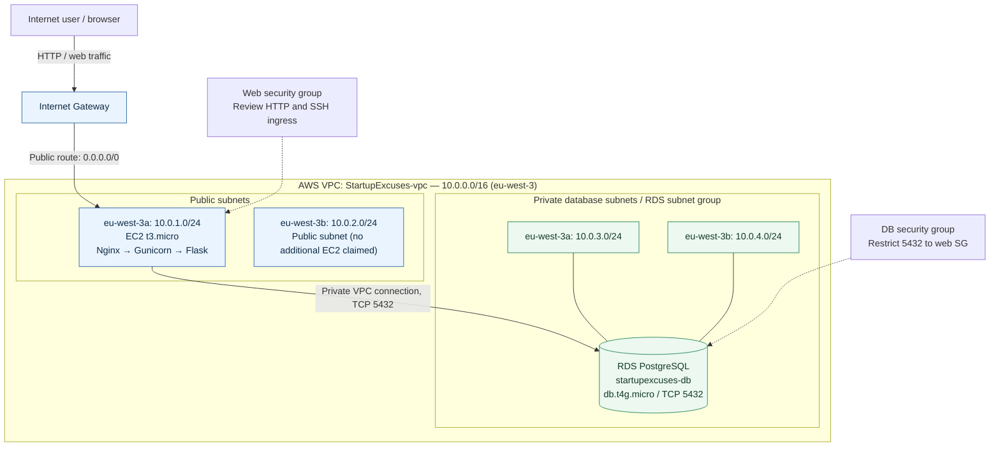

# AWS architecture — editable Mermaid diagram

GitHub renders the following Mermaid source automatically. This diagram represents the lab's logical design, not every configured AWS setting.

**Routing clarification:** public subnets use an Internet Gateway default route; the private database subnets have only the local VPC route in the documented lab. The diagram does not imply that the database has its own public endpoint or an outbound NAT route. An RDS subnet group across two AZs does not alone prove Multi-AZ database deployment.
